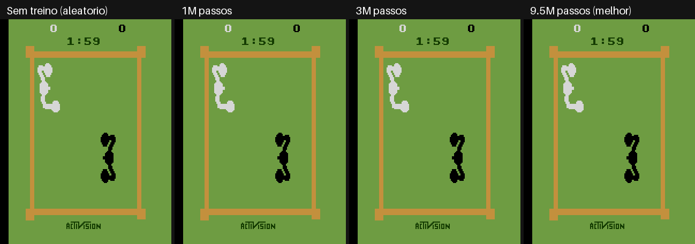
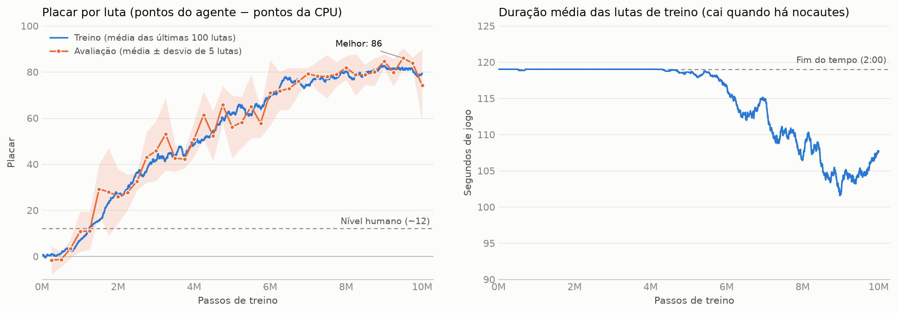

# Agente PPO jogando Atari Boxing

Trabalho de **Aprendizado por Reforço**: um agente treinado com **PPO** ([Stable-Baselines3](https://stable-baselines3.readthedocs.io/)) aprende a jogar [Boxing do Atari 2600](https://ale.farama.org/environments/boxing/) usando só os pixels da tela.



*Primeiros 10 segundos de uma luta em quatro etapas do treino. O agente é o boxeador branco.*

## Resultados

Avaliação do melhor modelo em **20 lutas novas**, comparado a um agente que escolhe ações ao acaso:

| | Agente aleatório | **PPO (9,5M passos)** |
|---|---|---|
| Placar médio (pontos do agente − pontos da CPU) | +1,2 ± 5,8 | **+82,0 ± 10,4** |
| Vitórias / empates / derrotas | 10 / 3 / 7 | **20 / 0 / 0** |
| Nocautes aplicados (chegar a 100 pontos) | 0 de 20 | **19 de 20** |
| Duração média da luta | 119 s (tempo esgota) | **106 s** |

Para comparação, um jogador humano faz cerca de 12 pontos, e o DQN original da DeepMind (2015) fez ~70.



- O agente passa do nível humano por volta de **1,5M passos**.
- Chega a **~80 pontos aos 7M passos** e fica num platô entre 80 e 86.
- A partir de **~4,5M passos**, as lutas começam a terminar antes dos 2 minutos, porque o agente passa a nocautear a CPU.
- A estratégia aprendida é ir direto até o oponente, ficar frente a frente e socar sem parar.

Análise completa no notebook **[`boxing_ppo.ipynb`](boxing_ppo.ipynb)**.

## Vídeos

Lutas completas de 2 minutos, em [`resultados/videos/`](resultados/videos):

| Etapa | Vídeo |
|---|---|
| Sem treino (ações aleatórias) | [00_agente_aleatorio.mp4](resultados/videos/00_agente_aleatorio.mp4) |
| 1M passos | [boxing_001000000_passos.mp4](resultados/videos/boxing_001000000_passos.mp4) |
| 3M passos | [boxing_003000000_passos.mp4](resultados/videos/boxing_003000000_passos.mp4) |
| 5M passos | [boxing_005000000_passos.mp4](resultados/videos/boxing_005000000_passos.mp4) |
| 10M passos | [boxing_010000000_passos.mp4](resultados/videos/boxing_010000000_passos.mp4) |
| **Melhor modelo (9,5M passos)** | **[melhor_modelo.mp4](resultados/videos/melhor_modelo.mp4)** |

Há um vídeo para cada milhão de passos de treino.

## Como funciona

**Pré-processamento** (wrappers de Atari do SB3):
- imagem em escala de cinza, 84×84;
- cada ação repetida por 4 frames;
- os últimos 4 frames empilhados, para o agente perceber o movimento;
- até 30 ações NOOP aleatórias no início de cada luta.

O template original repetia as ações por 16 frames, porque o `ALE/...-v5` já faz frame skip de 4 e o `AtariWrapper` faz mais 4. Aqui isso foi corrigido com `frameskip=1`.

**Algoritmo:** PPO com `CnnPolicy` (Nature CNN), 8 ambientes em paralelo e os hiperparâmetros de Atari do [RL Baselines3 Zoo](https://github.com/DLR-RM/rl-baselines3-zoo):

| Hiperparâmetro | Valor |
|---|---|
| `n_envs` | 8 |
| `n_steps` | 128 |
| `batch_size` | 256 |
| `n_epochs` | 4 |
| `learning_rate` | 2,5e-4, decaindo linearmente até 0 |
| `clip_range` | 0,1, decaindo linearmente até 0 |
| `ent_coef` | 0,01 |
| `vf_coef` | 0,5 |
| `total_timesteps` | 10M (cerca de 40M frames) |

**Tempo de treino:** cerca de 1h35 numa GPU NVIDIA RTX 2000 Ada (~1.750 passos/s).

## Estrutura

```
├── boxing_ppo.ipynb          # notebook principal: método, curvas, avaliação, vídeos e conclusão
├── train_boxing.py           # script de treino (PPO + checkpoints + avaliação periódica)
├── record_videos.py          # grava um vídeo de luta para cada checkpoint
├── requirements.txt
├── modelos/
│   ├── best_model.zip        # modelo treinado (melhor avaliação, 9,5M passos)
│   └── evaluations.npz       # histórico das avaliações durante o treino
├── resultados/
│   ├── avaliacao_final.json  # placar de cada uma das 20 lutas de avaliação
│   ├── curva_aprendizado.png
│   ├── evolucao.gif
│   ├── tensorboard/          # logs completos do treino
│   └── videos/               # uma luta completa por etapa do treino
└── referencia/
    └── template_freeway_professor.ipynb   # template original (Freeway) usado como base
```

## Como reproduzir

Requer Python 3.12. O `requirements.txt` instala o PyTorch com CUDA 13.2. Sem GPU NVIDIA, troque essas linhas por apenas `torch`.

```
py -3.12 -m venv .venv
.venv\Scripts\python -m pip install -r requirements.txt
```

| Para... | Comando |
|---|---|
| ver os resultados | abra o `boxing_ppo.ipynb` com o kernel `.venv` (usa o modelo já treinado) |
| treinar do zero | `.venv\Scripts\python train_boxing.py` |
| gravar vídeos dos checkpoints durante o treino | `.venv\Scripts\python record_videos.py` (num segundo terminal) |
| abrir o TensorBoard | `.venv\Scripts\tensorboard --logdir resultados/tensorboard` |

## Autor

Lucas Buccini
